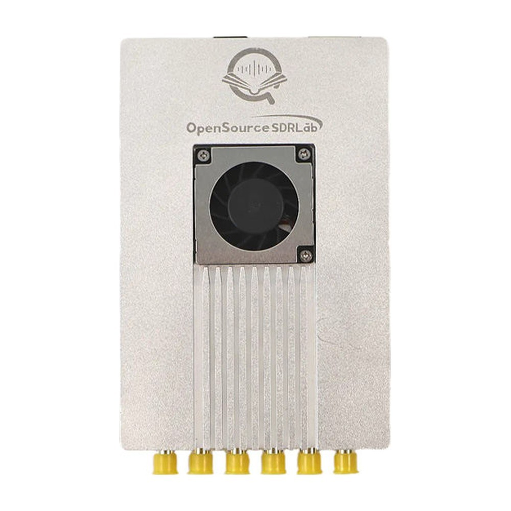
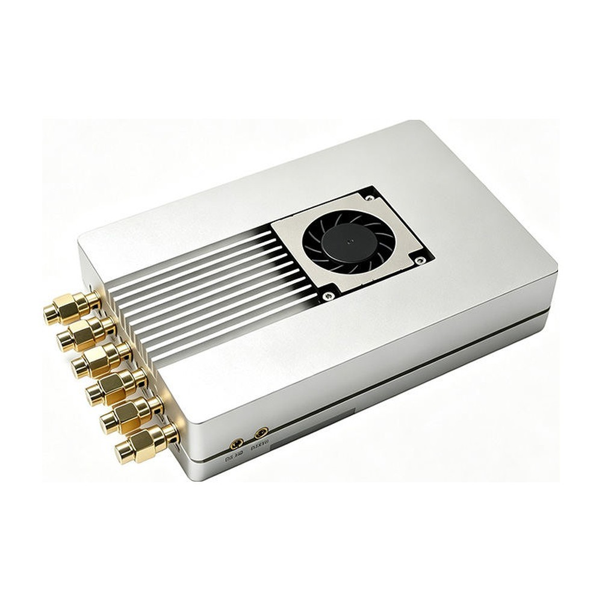

# XC7Z100-ADRV9371

Schematic, Linux (PetaLinux) and bare-metal reference designs and SD-card image for the **OpenSourceSDRLab XC7Z100-ADRV9371**, a stand-alone SDR board that combines a Xilinx Zynq-7000 XC7Z100 SoC with the Analog Devices ADRV9371 (AD9371) RF transceiver in an aluminium case.

  
  

## Product link

<https://opensourcesdrlab.com/products/opensourcesdrlab-high-performance-ad9371-board-for-fpga-sdr-with-silver-shell-1>

## About the board

- SoC: Xilinx Zynq-7000 **XC7Z100-2FFG900** (dual Cortex-A9 + Kintex-7-class fabric)
- RF transceiver: Analog Devices **ADRV9371** (AD9371; listed in the store as ADRV9371BBCZ / AD80414BBCZ), 300 MHz – 6 GHz, two transmit, two receive and two observation-receive channels on SMA connectors (TX1/TX2, RX1/RX2, ORX1/ORX2); receive bandwidth up to 100 MHz, transmit synthesis bandwidth up to 250 MHz
- Clocking: **AD9528** clock generator with 122.88 MHz VCXO, external reference input (REF_CLK), external TX/RX LO inputs
- Data path: four-lane **JESD204B** link between the ADRV9371 and the Zynq GTX transceivers
- Memory: 1 GB DDR3 on the PS, 1 GB DDR3 on the PL, 2 × 32 MB QSPI flash, microSD slot
- Interfaces: Gigabit Ethernet, USB 2.0 (Type-C), combined USB-JTAG/UART debug port (Type-C), GPS module with antenna input, 24 LVDS pairs on an extension connector
- Power: 12 V DC
- Software: PetaLinux **2022.2** with the Analog Devices Linux kernel (2022_R2) and IIO drivers; bare-metal designs for Vivado/Vitis **2021.1**

## Quick start

1. Write the SD-card image from the [Releases](../../releases) page to a microSD card.
2. Set the BOOT switch to SD, connect Ethernet, the DEBUG port and 12 V, and power on.
3. Log in on the serial console (115200 8N1) or connect to `192.168.1.10` with IIO Oscilloscope from Analog Devices.

The full steps are in the **[Quick Start Guide](docs/Quick-Start-Guide.md)** ([PDF](docs/Quick-Start-Guide.pdf)).

## Repository layout

| Path | Contents |
|---|---|
| `hardware/` | Board schematic (PDF) |
| `linux/` | PetaLinux 2022.2 project configuration, board-specific changes to the Analog Devices HDL and Linux kernel (2022_R2), hardware description (`.xsa`) and build instructions |
| `baremetal/ADRV9371_JESD204B_PL/` | Vivado 2021.1 project (PL): JESD204B link to the ADRV9371 |
| `baremetal/ADRV9371_JESD204B_PS/` | Vitis 2021.1 application sources (PS): ADRV9371 bring-up, lwIP TCP server, LED, DDR and USB tests |
| `baremetal/axi_ddr3_test/` | Vivado 2023.2 project: PL DDR3 test |
| `baremetal/lwip211_v2_0/` | The three files we changed in the Xilinx lwIP 2.1.1 library (YT8531 Ethernet PHY support) |
| `docs/` | Quick Start Guide (Markdown and PDF) |
| `images/` | Product photos |

## Downloads (Releases)

Large files are attached to the [Releases](../../releases) page instead of being stored in the repository:

| File | Contents |
|---|---|
| `XC7Z100-ADRV9371_SD-image_PetaLinux2022.2_120MiB.img.xz` | Complete SD-card image (two partitions, 120 MiB after decompression) |
| `XC7Z100-ADRV9371_SD-boot-files_PetaLinux2022.2.zip` | The same boot files and root filesystem as separate files (`BOOT.BIN`, `image.ub`, `boot.scr`, `system.dtb`, `rootfs.tar.gz`) |
| `XC7Z100-ADRV9371_JESD204B-baremetal_prebuilt_Vivado2021.1.zip` | Prebuilt bare-metal files: bitstream, `.ltx`, `.xsa`, FSBL and application `.elf` files |
| `XC7Z100-ADRV9371_PL-DDR3-test_prebuilt_Vivado2023.2.zip` | Prebuilt PL DDR3 test bitstream and debug probes |
| `SHA256SUMS.txt` | SHA-256 checksums of the files above |

Check a download with `shasum -a 256 -c SHA256SUMS.txt` (macOS / Linux) or `certutil -hashfile <file> SHA256` (Windows).

## Licence

Files created by OpenSourceSDRLab are released under the [Apache License 2.0](LICENSE). Parts of the reference designs come from Analog Devices, Xilinx/AMD and open-source projects (Linux, U-Boot, lwIP) and remain under their own licences; see [NOTICE.md](NOTICE.md).

The SD-card image contains GPL software (Linux kernel, U-Boot, BusyBox and other packages). Where its source code comes from is described in [NOTICE.md](NOTICE.md) and [linux/README.md](linux/README.md); to receive the complete corresponding source code, write to support@opensourcesdrlab.com.

## Support

- Email: support@opensourcesdrlab.com
- Forum: <https://forum.opensourcesdrlab.com>
- Discord: <https://discord.gg/nnxY6DkmvT>
- Blog and user manuals: <https://blog.opensourcesdrlab.com>

---
© 2026 OpenSourceSDRLab. All rights reserved. · <a href="https://www.opensourcesdrlab.com">www.opensourcesdrlab.com</a>
