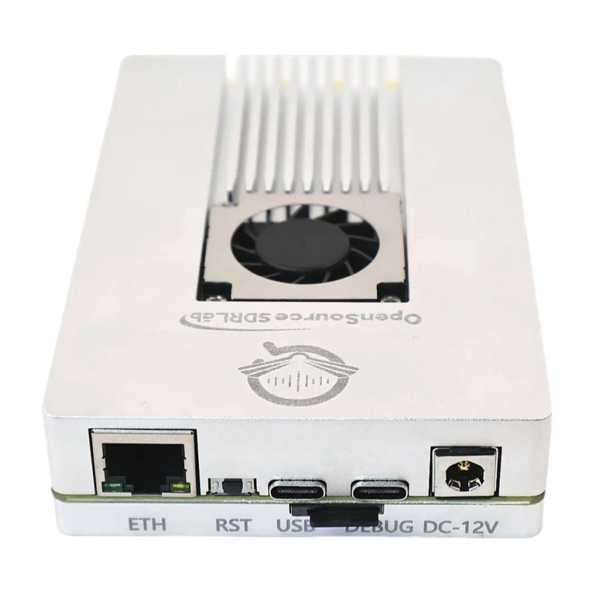

<!-- ossl:header -->

# XC7Z100-ADRV9371 Quick Start Guide

| Product | Document | Version | Date |
|---|---|---|---|
| XC7Z100-ADRV9371 | OSSDRLAB-XC7Z100-ADRV9371-QSG | 1.0 | 2026-11-12 |
<!-- /ossl:header -->

## 1. Overview

The XC7Z100-ADRV9371 is a stand-alone software-defined radio built around a Xilinx Zynq-7000 XC7Z100 SoC and the Analog Devices ADRV9371 (AD9371) RF transceiver. The transceiver's two transmit, two receive and two observation-receive channels are on SMA connectors; the ADRV9371 is connected to the Zynq through a four-lane JESD204B link and clocked by an AD9528 clock generator.

This guide shows how to boot the board from the prebuilt Linux SD-card image, how to reach the radio over the network, how to run the bare-metal reference designs, and how to rebuild everything from the sources in this repository.

## 2. What you need

| Item | Notes |
|---|---|
| XC7Z100-ADRV9371 board | with the 12 V power adapter and Ethernet cable from the package |
| microSD card | 1 GB or larger (the image is 120 MiB) |
| USB Type-C cable | for the DEBUG port (serial console and JTAG) |
| PC | Windows or Linux, with an Ethernet port |
| SD-card image | `XC7Z100-ADRV9371_SD-image_PetaLinux2022.2_120MiB.img.xz` from the [Releases](../../../releases) page |
| SD-card writing tool | any image writer, for example balenaEtcher or Win32 Disk Imager, or `dd` on Linux |
| Serial terminal | any terminal program (115200 baud, 8 data bits, no parity, 1 stop bit) |
| IIO Oscilloscope (optional) | from Analog Devices: <https://github.com/analogdevicesinc/iio-oscilloscope/releases> |
| Vivado / Vitis 2021.1 (optional) | for the bare-metal designs: <https://www.xilinx.com/support/download.html> |
| PetaLinux 2022.2 on Ubuntu (optional) | to rebuild the Linux image: <https://www.xilinx.com/support/download/index.html/content/xilinx/en/downloadNav/embedded-design-tools.html> |

## 3. Board connectors

| Connector / control | Function |
|---|---|
| TX1, TX2 | transmit outputs (SMA) |
| RX1, RX2 | receive inputs (SMA) |
| ORX1, ORX2 | observation-receiver inputs (SMA) |
| TX_LO, RX_LO | external local-oscillator inputs for the transmitter and receiver |
| REF_CLK | external reference clock input for the AD9528 |
| GPS_ANT | antenna input of the on-board GPS module |
| ETH | Gigabit Ethernet (PS) |
| USB | USB 2.0 (Type-C, PS) |
| DEBUG | USB-JTAG and USB-UART (Type-C); the serial console is PS UART0 |
| DC-12V | 12 V power input |
| RST | reset button |
| BOOT | boot-mode switch (SD card or QSPI flash) |
| LED, PWR, DONE, CLK0, CLK1 | status LEDs: user LED, power, FPGA configured, AD9528 clock status |

See `hardware/XC7Z100-ADRV9371_Schematic.pdf` for the full schematic.

## 4. Boot Linux from the SD card

1. Decompress `XC7Z100-ADRV9371_SD-image_PetaLinux2022.2_120MiB.img.xz` (for example with 7-Zip, or `xz -d` on Linux) and write the `.img` file to the microSD card with your SD-card writer. On Linux:

        lsblk                                   # find the SD card, for example /dev/sdb
        sudo umount /dev/sdX* 2>/dev/null || true
        sudo dd if=XC7Z100-ADRV9371_SD-image_PetaLinux2022.2_120MiB.img of=/dev/sdX bs=4M conv=fsync
        sync

    Replace `/dev/sdX` with the SD card, never with a system disk.

2. The card now has two partitions: `BOOT` (FAT32, 48 MiB: `BOOT.BIN`, `image.ub`, `boot.scr`, `system.dtb`) and `rootfs` (ext4, the root filesystem).

3. Insert the card, set the BOOT switch to **SD card boot**, connect the Ethernet cable and the DEBUG port to your PC, then connect the 12 V supply.

4. Open the serial port of the DEBUG connector (115200 8N1). FSBL, U-Boot and Linux all print to this console. Log in as `root` with password `root`, and change the password with `passwd` before connecting the board to a shared network.

5. The board's Ethernet address is `192.168.1.10` (gateway `192.168.1.1`). Give your PC an address in the same subnet, for example `192.168.1.100`, and check the link with `ping 192.168.1.10`.

6. When the ADRV9371 driver has finished initialising the radio, the user LED blinks every 500 ms (service `adrv9371-heartbeat`). If the LED stays off, check the serial console for driver messages.

> **Tip:** to update only the boot files or the root filesystem, use `XC7Z100-ADRV9371_SD-boot-files_PetaLinux2022.2.zip` instead of the whole image: copy `BOOT.BIN`, `image.ub`, `boot.scr` and `system.dtb` to the FAT32 partition, and extract `rootfs.tar.gz` to the ext4 partition with `sudo tar -xpf rootfs.tar.gz -C <mount point>`.

## 5. Use the radio

The Linux image runs the Analog Devices IIO drivers for the ADRV9371 and the IIO daemon (`iiod`), so the radio can be used over the network:

1. Start IIO Oscilloscope on the PC and connect to `ip:192.168.1.10`.
2. Set the LO frequencies, gains and the transmit waveform on the ADRV9371 tabs, and watch the received spectrum on the capture window.
3. On the board itself, the radio devices are under `/sys/bus/iio/devices/` (device name `ad9371-phy`); the `ensm_mode` attribute shows `radio_on` when the transceiver is running.

Any software that uses libiio (GNU Radio IIO blocks, MATLAB, Python `pyadi-iio`) can connect to the same address.

## 6. Bare-metal reference designs

The bare-metal designs use the same board without Linux. Prebuilt files are in `XC7Z100-ADRV9371_JESD204B-baremetal_prebuilt_Vivado2021.1.zip` and `XC7Z100-ADRV9371_PL-DDR3-test_prebuilt_Vivado2023.2.zip` on the [Releases](../../../releases) page.

| File | What it does |
|---|---|
| `FMC_AD9371_PS.elf` | Initialises the AD9528 and the ADRV9371, loads the ARM firmware, runs the calibrations, brings up the JESD204B links, sets both LOs to 1500 MHz and prints the status on the serial console |
| `TCP_Server.elf` | lwIP TCP server for throughput tests with `iperf -c 192.168.1.10 -i 5 -t 300 -w 2M` |
| `LED.elf` | blinks the user LED |
| `DDR_Test.elf` | PS DDR3 memory test |
| `xusbps_intr_example_1.elf` | USB 2.0 device example (mass storage) |
| `ddr3_top.bit` (DDR3 test package) | PL DDR3 write/read test; open with its `.ltx` file in Vivado Hardware Manager |

To run an application over JTAG:

1. Connect the DEBUG port and power the board. In Vivado Hardware Manager the XC7Z100 appears on the USB-JTAG cable.
2. In Vitis 2021.1, create a platform from `jesd204b_adc_dac_top.xsa`, then use **Run As > Launch Hardware**, or program `jesd204b_adc_dac_top.bit` and download the `.elf` with XSCT.
3. Watch the output on the serial console (115200 8N1).

To boot a bare-metal application from the SD card, create `BOOT.bin` with bootgen from `fsbl.elf`, the bitstream and the application `.elf`, and copy it to a FAT32-formatted card.

## 7. Rebuild from source

### 7.1 Linux image (PetaLinux 2022.2)

The `linux/` folder holds the board-specific part of the PetaLinux project. The full steps, including which upstream Analog Devices sources to combine it with, are in `linux/README.md`. In short:

1. On Ubuntu with PetaLinux 2022.2 installed, assemble the project tree as described in `linux/README.md` (Analog Devices `hdl`, `linux` and `meta-adi` at release 2022_R2 plus the files and patch from this repository), then run `bash prepare.sh` once.

2. Load the PetaLinux environment (use your own installation path):

        source <petalinux-2022.2-install-dir>/settings.sh

3. Import the hardware description and the root-filesystem configuration, then build:

        cd petalinux
        petalinux-config --get-hw-description=../hardware --silentconfig
        petalinux-config -c rootfs --silentconfig
        petalinux-build

4. Create `BOOT.BIN`:

        petalinux-package --boot --fsbl images/linux/zynq_fsbl.elf --fpga images/linux/system.bit \
          --u-boot images/linux/u-boot.elf --dtb images/linux/system.dtb --force

5. Copy `BOOT.BIN`, `image.ub`, `boot.scr` and `system.dtb` from `petalinux/images/linux/` to the FAT32 partition and extract `rootfs.tar.gz` to the ext4 partition (see the tip in section 4).

`linux/hardware/system_top.xsa` is the prebuilt hardware description (PS configuration, ADRV9371 interface and PL DDR3 controller). Rebuild it with Vivado 2022.2 only if you change the HDL in `linux/hdl/`.

### 7.2 Bare-metal designs (Vivado / Vitis 2021.1)

1. Open `baremetal/ADRV9371_JESD204B_PL/JESD204B_TX_RX.xpr` in Vivado 2021.1, generate the bitstream and export the hardware (`.xsa`). A ready-made `.xsa` is in `baremetal/ADRV9371_JESD204B_PS/`.

2. Download the Mykonos ARM firmware header `Mykonos_M3.h` from Analog Devices into `baremetal/ADRV9371_JESD204B_PS/FMC_AD9371_PS/ad9371/`. It is not part of this repository; `ad9371/README.md` gives the link (ADI no-OS, branch `2018_R1`) and the SHA-256 value to check.

3. For `TCP_Server`, prepare the lwIP library as described in `baremetal/lwip211_v2_0/README.md` and add it to Vitis as a software repository (**Xilinx > Software Repositories**), so that the platform uses `lwip211` version 2.0.

4. In Vitis 2021.1, create a platform from the `.xsa` (standalone, `ps7_cortexa9_0`), then an empty bare-metal C application for each folder in `baremetal/ADRV9371_JESD204B_PS/`, and import its sources. For `FMC_AD9371_PS`, import the folders `src`, `ad9371`, `ad9528`, `drivers` and `mykonos`, and add them to the include directories (ARM v7 gcc compiler > Directories):

        src
        ad9371
        ad9528
        drivers
        mykonos
        mykonos/mykonos_debug

5. Build the application, then run it over JTAG or create `BOOT.bin` as in section 6.

The PL DDR3 test is a Vivado 2023.2 project: open `baremetal/axi_ddr3_test/prj/axi_ddr3_test/axi_ddr3_test.xpr` and generate the bitstream.

## 8. Support

- Product page: <https://opensourcesdrlab.com/products/opensourcesdrlab-high-performance-ad9371-board-for-fpga-sdr-with-silver-shell-1>
- Email: support@opensourcesdrlab.com
- Forum: <https://forum.opensourcesdrlab.com>
- Discord: <https://discord.gg/nnxY6DkmvT>

<!-- ossl:footer -->
---
© 2026 OpenSourceSDRLab. All rights reserved. · <a href="https://www.opensourcesdrlab.com">www.opensourcesdrlab.com</a>
<!-- /ossl:footer -->
